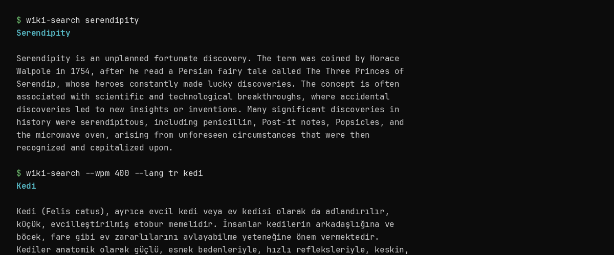

# wiki

A Rust CLI to read Wikipedia and other sources



## Why it exists

Reading an article should not cost a browser tab and a page of layout. This
tool fetches a source, reduces it to text, and prints it with the terminal width
as the only formatting decision.

## How it works

1. The query is joined from the arguments, URL-encoded, and sent to the selected
   source.
2. Wikipedia is queried through its API (`generator=search`, `prop=extracts`,
   `explaintext=1`). The intro is requested with `exintro=1`; `--full` asks for
   the complete article.
3. It's FOSS is searched through its Ghost content API. The search index is
   downloaded, scored locally, and the best post is fetched as plain text.
4. wikiHow is loaded in a local headless Chromium or Chrome because the site
   blocks plain automated requests. The rendered page is reduced to its intro,
   steps, tips, and warnings.
5. Text prints immediately by default. `--slow` switches to word-by-word
   reading: each word waits `60000 / wpm` milliseconds, commas add 110 ms,
   sentence ends add 220 ms, and paragraph breaks add 450 ms.
6. Lines wrap to `COLUMNS`, or 80 when it is unset. Every source line ends with
   a newline, so paragraphs stay separate.
7. `--json` returns the source, query, title, and full extracted text for
   scripts.
8. TLS is handled by `rustls`. Requests have a 10-second connect timeout, a
   60-second overall timeout, and a 16 MiB response cap.

## Usage

```bash
wiki [OPTIONS] <QUERY>

Options:
  -s, --source <NAME>  Source: wikipedia, itsfoss, or wikihow (default: wikipedia)
  -w, --wpm <N>        Reading speed in words per minute (implies --slow)
      --slow           Print at reading speed
  -f, --full           Print the whole Wikipedia article, not just the intro
  -l, --lang <CODE>    Wikipedia language code (default: en)
      --json           Print the article as JSON
  -h, --help           Print help
  -V, --version        Print version

Examples:
  wiki rust programming language
  wiki --slow alan turing
  wiki --wpm 300 alan turing
  wiki --full history of the bicycle
  wiki --lang tr kedi
  wiki --source itsfoss linux mint
  wiki --json --full history of the bicycle
  COLUMNS=100 wiki serendipity
```

## Notes

- Sources: `wikipedia` (any language through `--lang`), `itsfoss` (top result
  from the Ghost search index), and `wikihow` (top result, rendered with a local
  headless browser).
- A query with no matching article exits `1` and prints the reason on stderr.
- `--wpm` implies `--slow`. In slow mode every word is flushed as it prints, so
  the pace is visible even when output is redirected.
- Only the selected source is contacted, with read-only `GET` requests. The
  wikiHow browser uses a temporary local profile and no third-party reader
  proxy. No credentials, cookies, configuration, or telemetry are read or sent.
- Control characters are stripped from article text before printing. Unsafe
  code is forbidden by the package lint configuration.

## Install

**Requirements:** Rust 1.88+, `git`, and Chromium or Chrome for
`--source wikihow`.

```bash
cargo install --git https://github.com/batusaribay/wiki.git --locked
```

## License

This project is licensed under the [MIT License](LICENSE).
